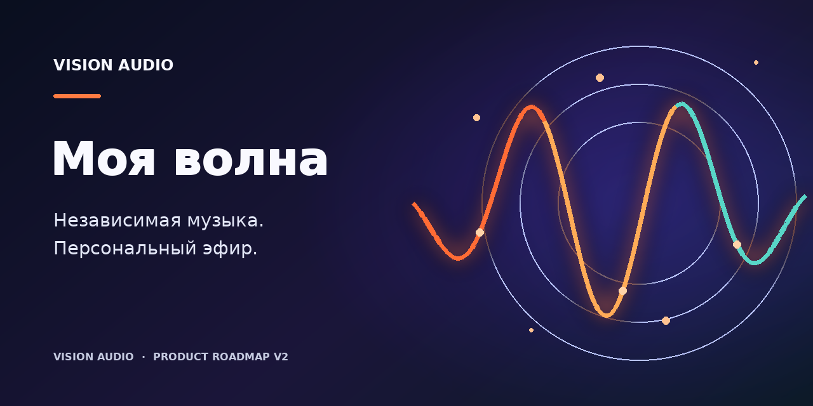

# Vision Audio

**Независимая музыка. Персональная волна.**

Мы создаём пространство, где слушатели открывают новых независимых артистов, а музыка складывается в персональный эфир «Моя волна».

## Идея

- **Открытия** — находить музыку за пределами привычного каталога.
- **Персональный эфир** — слушать собственную волну, а не собирать очередь вручную.
- **Доверие** — делиться музыкой только с подтверждёнными правами и понятными правилами.

## Статус

Vision Audio v2 находится в разработке. Публичная платформа, персональное радио и загрузка музыки пока не запущены. Сейчас нет открытой беты; мы не принимаем музыкальные файлы и не набираем участников.

## Демоверсия

[Открыть раннюю демоверсию плеера](https://visiontripin.github.io/Vision/). Это существующий прототип личной библиотеки, а не Vision Audio v2 и не демоверсия будущего радио.
